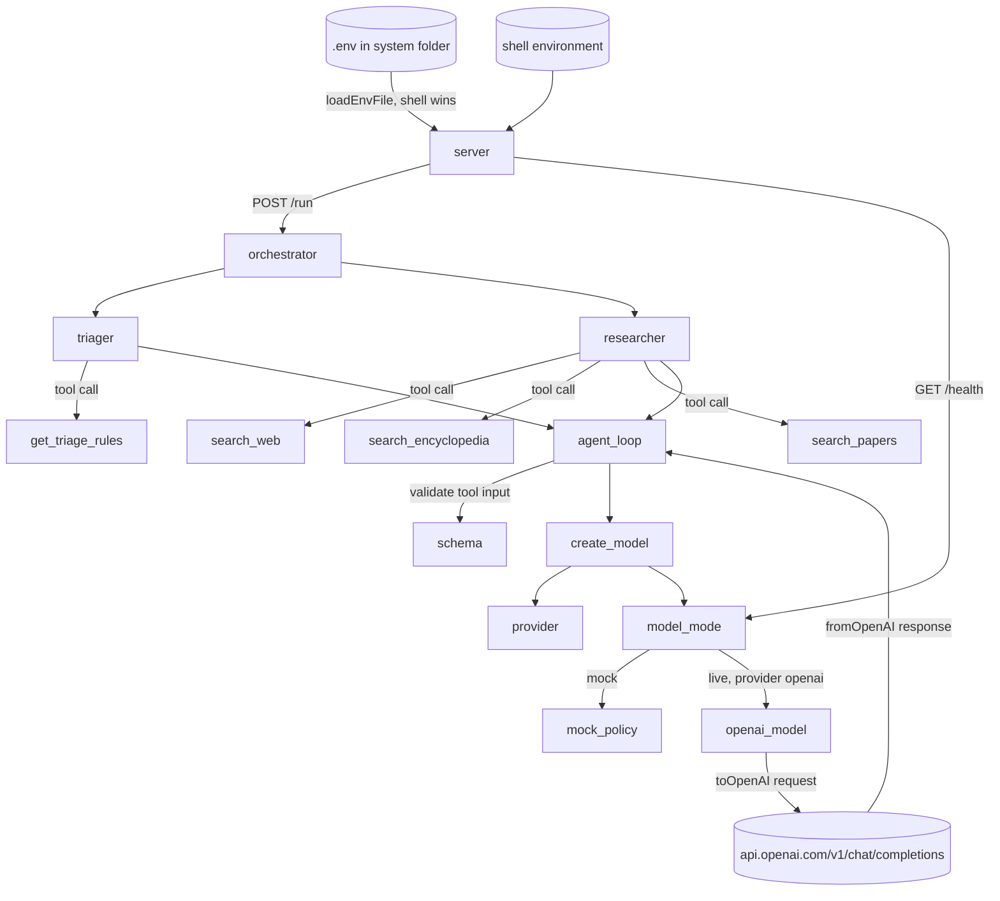

# Design: Switch systems to OpenAI keys

System folder: systems/support-triage/
Second system folder: systems/research-summary/

Job: 20261026-openai-env. Round: 0. Branch: okati/20261026-openai-env.

This job changes two existing systems. It does not make a new system. The plan says "Do not build a new system", so this design does not make `systems/openai-env/`.

## Summary

Both systems use the current template library `lib/` and select OpenAI with `AGENT_PROVIDER=openai`. Live model requests go only to `https://api.openai.com/v1/chat/completions`. Mock mode does not change.

| System | Changes |
| --- | --- |
| `support-triage` | Copy the three template `lib/` files. Add the template `.env` load step to `server.js`. Change `.env.example` and the `README.md` table. Add `fixtures/openai_responses.json` and four test files. |
| `research-summary` | `lib/` is already equal to the template. Do not change it. Change `.env.example` and the `README.md` table. Add `fixtures/openai_responses.json` and two test files. |

### Files to change

| File | Change |
| --- | --- |
| `systems/support-triage/lib/llm.js` | Replace with a byte copy of `okati/templates/agent-system/lib/llm.js`. |
| `systems/support-triage/lib/agent-loop.js` | Replace with a byte copy of `okati/templates/agent-system/lib/agent-loop.js`. The new loop does not read `AGENT_MODEL`. |
| `systems/support-triage/lib/schema.js` | Replace with a byte copy of the template file. It is already equal. Do a byte copy again. |
| `systems/support-triage/server.js` | Add one line as the first line of the `if (import.meta.url === ...)` block, before `checkPort`: `try { process.loadEnvFile(new URL("./.env", import.meta.url)); } catch {}`. Put the template comment above it: `// Load keys from a local .env file, if one exists. Values in the shell win.` Do not change other lines. |
| `systems/support-triage/.env.example` | See "Contract: .env.example (support-triage)". |
| `systems/support-triage/README.md` | See "Contract: README.md environment variable table". |
| `systems/support-triage/fixtures/openai_responses.json` | New. See "Test doubles and fixture data". |
| `systems/support-triage/tests/llm.test.js` | New. Byte copy of `okati/templates/agent-system/tests/llm.test.js`. 3 tests. |
| `systems/support-triage/tests/env.test.js` | New. 2 tests: T4, T5. |
| `systems/support-triage/tests/live-openai.test.js` | New. 5 tests: T12 with T13, T14, E1, E2, E3. |
| `systems/support-triage/tests/config.test.js` | New. 3 tests: T1, T6 with T7 and T10, T11. |
| `systems/research-summary/.env.example` | See "Contract: .env.example (research-summary)". |
| `systems/research-summary/README.md` | See "Contract: README.md environment variable table". |
| `systems/research-summary/fixtures/openai_responses.json` | New. See "Test doubles and fixture data". |
| `systems/research-summary/tests/live-openai.test.js` | New. 5 tests: T12 with T13, T14, E1, E2, E3. |
| `systems/research-summary/tests/config.test.js` | New. 3 tests: T2, T8 with T9 and T10, T11. |

Do not change other files. Do not change the agents, the tools, the orchestrators, `package.json`, `evals/cases.json` or the existing tests. Do not change `research-summary/lib/`, `research-summary/server.js` or `research-summary/tests/llm.test.js`. They are already correct.

### Test counts

| System | Old `npm test` count | New tests | New `npm test` count | `npm run evals` |
| --- | --- | --- | --- | --- |
| `support-triage` | 65 | 13 (3 + 2 + 5 + 3) | 78 | 20 of 20 cases pass |
| `research-summary` | 79 | 8 (5 + 3) | 87 | 20 of 20 cases pass |

## Agents

This job adds no agent. The existing agents do not change. The `model` field in each agent stays `"claude-sonnet-5-5"`. The OpenAI path ignores this field and sends `OPENAI_MODEL`.

| Agent | Role | Model | Tools |
| --- | --- | --- | --- |
| `triager` (support-triage) | Selects one team and one priority for one ticket. Gives a reason, a confidence value and the language. No change. | Live: `OPENAI_MODEL` through `AGENT_PROVIDER=openai`. Mock: `triager.mock`. | `get_triage_rules` |
| `researcher` (research-summary) | Calls three search tools in one turn, then writes a summary with `[n]` markers. No change. | Live: `OPENAI_MODEL` through `AGENT_PROVIDER=openai`. Mock: `researcher.mock`. | `search_web`, `search_encyclopedia`, `search_papers` |

Prompt summaries do not change. See `agents/triager.js` and `agents/researcher.js`.

## Agent graph

The graph shows the model path that this job changes. The other nodes of each system graph do not change. See the `README.md` of each system.



Node IDs and code names:

| Node ID | Code |
| --- | --- |
| `server` | `server.js` |
| `orchestrator` | `orchestrator.js` `run()` |
| `agent_loop` | `lib/agent-loop.js` `runAgent()` |
| `schema` | `lib/schema.js` `validate()` |
| `create_model` | `lib/llm.js` `createModel()` |
| `provider` | `lib/llm.js` `provider()` |
| `model_mode` | `lib/llm.js` `modelMode()` |
| `mock_policy` | `agent.mock(messages)` |
| `openai_model` | `lib/llm.js` `openaiModel()` (not exported) |
| `openai_api` | `OPENAI_URL` in `lib/llm.js`. In tests, the `globalThis.fetch` stub. |

Sequence for one agent run in live mode with OpenAI:

1. `runAgent` calls `createModel(agent)`. In `support-triage`, `countingModel()` calls it.
2. `createModel` reads `AGENT_MODE`, `AGENT_PROVIDER`, `OPENAI_API_KEY` and `OPENAI_MODEL` from `process.env`.
3. For each turn, `model.call(request)` changes the request with `toOpenAI`, sends it with `fetch` and changes the response with `fromOpenAI`.
4. `runAgent` validates each tool input against the tool schema. Then it runs the tool or returns a tool error result.
5. `support-triage`: 2 model calls for each valid ticket (rules call, then final JSON). `research-summary`: 2 model calls for each question (three search calls, then final JSON).

## Tool contracts

### Existing tools

No change. The input schemas, output schemas and error codes of `get_triage_rules`, `fetch_new_tickets`, `update_ticket`, `search_web`, `search_encyclopedia` and `search_papers` stay as they are.

Each model tool has an input schema with `additionalProperties: false` and no properties. Thus `fromOpenAI` changes arguments that are not JSON into `{ "_unparsed": "<text>" }`, and `validate()` refuses this input. The agent loop returns a tool result with `invalid_input`. E3 uses this behavior.

### Contract: model client (`lib/llm.js`, template copy)

Do not change this code. The error messages are fixed by the template. The design gives each error case one `snake_case` code for tests and reviews.

| Function | Input | Output |
| --- | --- | --- |
| `provider()` | `process.env.AGENT_PROVIDER`, `OPENAI_API_KEY`, `ANTHROPIC_API_KEY` | `"openai"` or `"anthropic"` |
| `modelMode()` | `process.env.AGENT_MODE` (`auto`, `mock`, `live`) and the provider key | `"mock"` or `"live"` |
| `createModel(agent)` | agent object with `mock(messages)` | `{ mode, call(request) }` |
| `model.call(request)` | `{ model, max_tokens, system, tools: [{ name, description, input_schema }], messages }` (Anthropic Messages format) | `{ content: [text or tool_use blocks], stop_reason: "tool_use" or "end_turn" }` |

OpenAI request that `model.call` sends:

- URL: `https://api.openai.com/v1/chat/completions`
- Method: `POST`
- Headers: `content-type: application/json`, `authorization: Bearer <OPENAI_API_KEY>`
- Body: `{ "model": <OPENAI_MODEL>, "max_completion_tokens": 1024, "messages": [system, user, assistant with tool_calls, tool, ...], "tools": [{ "type": "function", "function": { "name", "description", "parameters" } }] }`

| Error code | Condition | Exact error message |
| --- | --- | --- |
| `provider_invalid` | `AGENT_PROVIDER` has a value that is not `anthropic` or `openai`. | `AGENT_PROVIDER must be anthropic or openai, got <value>` |
| `openai_key_missing` | `AGENT_MODE=live`, provider `openai`, `OPENAI_API_KEY` empty. | `AGENT_MODE=live needs OPENAI_API_KEY` |
| `openai_model_missing` | Live mode, provider `openai`, `OPENAI_MODEL` empty. | `AGENT_PROVIDER=openai needs OPENAI_MODEL` |
| `model_http_<status>` | OpenAI returns a status that is not 2xx. Example: `model_http_401`. | `model_http_<status>` |
| `invalid_input` | A tool call has arguments that are not JSON, or arguments that the tool schema refuses. Tool result, not a throw. | tool result content `{"error":"invalid_input","details":[...]}` |
| `unknown_tool` | The model calls a tool that the agent does not have. Tool result. | `{"error":"unknown_tool"}` |
| `tool_failed` | The tool throws. Tool result. | `{"error":"tool_failed"}` |
| `max_turns` | 5 model turns with no final text. | `AgentError` code `max_turns` |
| `bad_output` | The final text is not JSON or does not agree with the output schema. | `AgentError` code `bad_output` |

System behavior on a model error does not change. `support-triage` retries once and then sends the ticket to review. `research-summary` returns `internal_error`.

### Contract: `.env` load (`support-triage/server.js`)

- Input: a file `.env` in the system folder (next to `server.js`). The file is optional.
- Step: `process.loadEnvFile(new URL("./.env", import.meta.url))` in the main block only, before `checkPort`. A missing file or a parse error is ignored (`catch {}`).
- Precedence: a variable that is set in the shell keeps its shell value. `process.loadEnvFile` does not replace a variable that is set.
- Tests that import `server.js` do not load `.env`. Only `node server.js` loads it.
- Needs Node.js 20.12 or later.

| Error code | Condition | Result |
| --- | --- | --- |
| `env_file_missing` | No `.env` file. | Ignored. The server uses the shell values. |
| `port_invalid` | `PORT` is not 3000 to 3999. | Existing behavior: `checkPort` throws `PORT must be 3000 to 3999, got <value>`. |

### Contract: `.env.example` (support-triage)

Write exactly these keys, in this sequence. Comments are permitted. No comment can contain the names of the two removed Anthropic variables (see T10).

```
# Copy this file to .env in the same folder, then fill in the values.
# .env is in .gitignore. Do not commit it. Values set in the shell win.

# Port from 3000 to 3999.
PORT=3142

# auto, mock or live. auto uses live only when OPENAI_API_KEY has a value.
# Tests and the localhost run always use mock.
AGENT_MODE=auto

# Model provider.
AGENT_PROVIDER=openai

# OpenAI: the API key and the model name from your OpenAI account. Do not commit a value.
OPENAI_API_KEY=
OPENAI_MODEL=

# fake or rest.
TICKET_ADAPTER=fake
# Needed only for the rest adapter.
TICKET_API_URL=
# Needed only for the rest adapter. Do not commit a value.
TICKET_API_TOKEN=
# Path of the configuration file.
TRIAGE_CONFIG=fixtures/triage_config.json
# Schedule interval in minutes. 0 is off. Production value is 5.
TRIAGE_INTERVAL_MINUTES=0
# fixed or system. The default is fixed with the fake adapter.
TRIAGE_CLOCK=
# on or off.
TRIAGE_LOG=on
```

Keys: `PORT`, `AGENT_MODE`, `AGENT_PROVIDER`, `OPENAI_API_KEY`, `OPENAI_MODEL`, `TICKET_ADAPTER`, `TICKET_API_URL`, `TICKET_API_TOKEN`, `TRIAGE_CONFIG`, `TRIAGE_INTERVAL_MINUTES`, `TRIAGE_CLOCK`, `TRIAGE_LOG` (12 keys).

### Contract: `.env.example` (research-summary)

```
# Copy this file to .env in the same folder, then fill in the values.
# .env is in .gitignore. Do not commit it. Values set in the shell win.

# Port from 3000 to 3999.
PORT=3217

# auto, mock or live. auto uses live only when OPENAI_API_KEY has a value.
# Tests and the localhost run always use mock.
AGENT_MODE=auto

# Model provider.
AGENT_PROVIDER=openai

# OpenAI: the API key and the model name from your OpenAI account. Do not commit a value.
OPENAI_API_KEY=
OPENAI_MODEL=

# fake or http. Tests and the localhost run use fake.
SEARCH_ADAPTER=fake

# Needed only for the http adapter.
WEB_SEARCH_URL=
# Needed only for the http adapter. Do not commit a value.
WEB_SEARCH_KEY=
# Needed only for the http adapter.
ENCYCLOPEDIA_URL=
# Needed only for the http adapter.
PAPERS_URL=
# Needed only for the http adapter. Do not commit a value.
PAPERS_KEY=
```

Keys: `PORT`, `AGENT_MODE`, `AGENT_PROVIDER`, `OPENAI_API_KEY`, `OPENAI_MODEL`, `SEARCH_ADAPTER`, `WEB_SEARCH_URL`, `WEB_SEARCH_KEY`, `ENCYCLOPEDIA_URL`, `PAPERS_URL`, `PAPERS_KEY` (11 keys).

### Contract: README.md environment variable table

Each `README.md` has one table under `## Environment variables` with the columns `Name | Default | Meaning`. The set of names in the first column (without backticks) is equal to the set of keys in `.env.example`. Use the same sequence as `.env.example`.

Model rows in both files:

| Name | Default | Meaning |
| --- | --- | --- |
| `AGENT_PROVIDER` | openai | Model provider. Use openai. |
| `OPENAI_API_KEY` | empty | OpenAI key. Needed only in live mode. |
| `OPENAI_MODEL` | empty | OpenAI model name. Needed only in live mode. |

- Remove the two Anthropic rows. Do not add an Anthropic note.
- `support-triage`: keep the other 9 rows. Replace the line "Keys are read from the environment only. Do not put a key in a file in the repository." with: "To add your keys, copy `.env.example` to `.env` in this folder and fill in the values. `npm start` reads `.env`. A value that is set in the shell has priority over `.env`. Git ignores `.env`. Do not commit a `.env` file or a key. `npm start` needs Node.js 20.12 or later."
- `research-summary`: keep the other 8 rows. Remove the line that starts with "`lib/llm.js` also supports OpenAI". Keep the `.env` text. Add "`npm start` needs Node.js 20.12 or later."

## Test doubles and fixture data

| Service | Test double | Fixture |
| --- | --- | --- |
| OpenAI Chat Completions API | A `globalThis.fetch` stub in `tests/live-openai.test.js`. It records each call as `{ url, headers, body }` and returns `new Response(JSON.stringify(body), { status, headers: { "content-type": "application/json" } })`. Restore the real `fetch` after each test. | `fixtures/openai_responses.json` in each system |
| Anthropic Messages API | Not used. The same stub records each URL. Each live test asserts that zero URLs contain `api.anthropic.com`. | none |
| Ticket REST API | Existing fake adapter. The tests delete `TICKET_ADAPTER` so the fake adapter is used. | `fixtures/tickets.json`, `fixtures/triage_config.json` |
| Search APIs | Existing `adapters/fake-search.js`. The tests delete `SEARCH_ADAPTER` so the fake adapter is used. | `fixtures/web_results.json`, `fixtures/encyclopedia_results.json`, `fixtures/paper_results.json` |
| Local `.env` file | A fixture `.env` in a temporary copy of `support-triage` under `os.tmpdir()`. Never in the repository folder. | Written by `tests/env.test.js` |

Test values (use these exact values in all new tests):

| Variable | Test value |
| --- | --- |
| `OPENAI_API_KEY` | `test-key-not-real` |
| `OPENAI_MODEL` | `test-model-not-real` |
| `AGENT_PROVIDER` | `openai` |
| `AGENT_MODE` | `live` (live tests), `auto` (E1), `mock` (T5) |

### `support-triage/fixtures/openai_responses.json`

Make each `final` body from the entry with the same key in `fixtures/model_responses.json`. Put one `final` entry for each of the 20 keys. The `content` value is `JSON.stringify({ team, priority, reason, confidence, language })` with the keys in this sequence. For `TCK-1020`, the `content` value is the `raw` string.

```json
{
  "rules_call": {
    "id": "chatcmpl-fixture-rules",
    "object": "chat.completion",
    "model": "test-model-not-real",
    "choices": [{ "index": 0, "finish_reason": "tool_calls", "message": { "role": "assistant", "content": null,
      "tool_calls": [{ "id": "call_rules_1", "type": "function", "function": { "name": "get_triage_rules", "arguments": "{}" } }] } }]
  },
  "bad_arguments_call": {
    "id": "chatcmpl-fixture-bad",
    "object": "chat.completion",
    "model": "test-model-not-real",
    "choices": [{ "index": 0, "finish_reason": "tool_calls", "message": { "role": "assistant", "content": null,
      "tool_calls": [{ "id": "call_bad_1", "type": "function", "function": { "name": "get_triage_rules", "arguments": "{bad" } }] } }]
  },
  "final": {
    "TCK-1001": {
      "id": "chatcmpl-fixture-TCK-1001",
      "object": "chat.completion",
      "model": "test-model-not-real",
      "choices": [{ "index": 0, "finish_reason": "stop", "message": { "role": "assistant",
        "content": "{\"team\":\"billing\",\"priority\":\"P2\",\"reason\":\"Duplicate card charge on an invoice. The customer needs a refund.\",\"confidence\":0.93,\"language\":\"en\"}" } }]
    }
  },
  "http_401": {
    "status": 401,
    "body": { "error": { "message": "Incorrect API key.", "type": "invalid_request_error", "code": "invalid_api_key" } }
  }
}
```

The example shows `TCK-1001` only. Add `TCK-1002` to `TCK-1020` in the same format.

Stub responder for T12 (`support-triage`): parse `init.body`. Find the first message with `role: "user"`. Parse its `content` and read `ticket_id`. If a message with `role: "tool"` exists, return `final[ticket_id]`. If not, return `rules_call`. Status 200.

### `research-summary/fixtures/openai_responses.json`

Make each `final` body from the entry with the same key in `fixtures/model_responses.json`. Put one `final` entry for each of the 6 questions. The `content` value is `JSON.stringify({ summary: sentences.map(s => s.text).join(" ") })`. This is the same text that the mock policy makes.

```json
{
  "search_calls": {
    "id": "chatcmpl-fixture-search",
    "object": "chat.completion",
    "model": "test-model-not-real",
    "choices": [{ "index": 0, "finish_reason": "tool_calls", "message": { "role": "assistant", "content": null,
      "tool_calls": [
        { "id": "call_web", "type": "function", "function": { "name": "search_web", "arguments": "{}" } },
        { "id": "call_encyclopedia", "type": "function", "function": { "name": "search_encyclopedia", "arguments": "{}" } },
        { "id": "call_papers", "type": "function", "function": { "name": "search_papers", "arguments": "{}" } }
      ] } }]
  },
  "bad_arguments_call": {
    "id": "chatcmpl-fixture-bad",
    "object": "chat.completion",
    "model": "test-model-not-real",
    "choices": [{ "index": 0, "finish_reason": "tool_calls", "message": { "role": "assistant", "content": null,
      "tool_calls": [{ "id": "call_bad_1", "type": "function", "function": { "name": "search_web", "arguments": "{bad" } }] } }]
  },
  "final": {
    "What is CRISPR?": {
      "id": "chatcmpl-fixture-crispr",
      "object": "chat.completion",
      "model": "test-model-not-real",
      "choices": [{ "index": 0, "finish_reason": "stop", "message": { "role": "assistant",
        "content": "{\"summary\":\"CRISPR is a gene editing technology that lets scientists change DNA at a chosen location [1]. CRISPR sequences were first found in bacteria as part of an immune defense against viruses [2]. The Cas9 enzyme cuts DNA at a site that a guide RNA selects [4]. Research shows that Cas9 can be programmed with RNA to cut specific DNA sequences [5]. One risk is unwanted cuts at DNA sites that are similar to the target site [7].\"}" } }]
    }
  },
  "http_401": {
    "status": 401,
    "body": { "error": { "message": "Incorrect API key.", "type": "invalid_request_error", "code": "invalid_api_key" } }
  }
}
```

The example shows one question only. Add the other 5 questions in the same format.

Stub responder for T12 (`research-summary`): parse `init.body`. Read `question` from the first message with `role: "user"`. If a message with `role: "tool"` exists, return `final[question]`. If not, return `search_calls`. Status 200.

### Test setup rules

- Each live test saves `process.env` and `globalThis.fetch` before it starts and restores both in `finally` (or in `afterEach`).
- Each live test sets `AGENT_MODE`, `AGENT_PROVIDER=openai`, `OPENAI_API_KEY=test-key-not-real`, `OPENAI_MODEL=test-model-not-real`. It deletes `ANTHROPIC_API_KEY` and `AGENT_MODEL`.
- `support-triage` live tests set `TRIAGE_LOG=off` and delete `TICKET_ADAPTER`, `TRIAGE_CONFIG` and `TRIAGE_CLOCK`.
- `research-summary` live tests delete `SEARCH_ADAPTER`.
- `llm.js` reads `process.env` at call time. Thus a test can set the variables after the import.
- The live tests call `run()` from `orchestrator.js` directly. They do not start an HTTP server.

### `support-triage/tests/env.test.js` (T4, T5)

1. In `before`: make a folder with `fs.mkdtempSync(path.join(os.tmpdir(), "support-triage-env-"))`. Copy the system folder into it with `fs.cpSync(src, dst, { recursive: true, filter })`. The filter refuses each path with the basename `node_modules` or `.env`. It keeps `.env.example`.
2. Write `<tmp>/.env` with these lines: `AGENT_PROVIDER=openai`, `OPENAI_API_KEY=test-key-not-real`, `OPENAI_MODEL=test-model-not-real`, `TRIAGE_LOG=off`.
3. Make a child environment from `process.env`. Delete `AGENT_MODE`, `AGENT_PROVIDER`, `OPENAI_API_KEY`, `OPENAI_MODEL`, `ANTHROPIC_API_KEY`, `AGENT_MODEL`, `TICKET_ADAPTER`, `TRIAGE_INTERVAL_MINUTES`. Set `PORT`.
4. Start `child_process.spawn(process.execPath, ["server.js"], { cwd: tmp, env })`.
5. Send `GET http://127.0.0.1:<port>/health` each 100 ms for a maximum of 10 s. Read the JSON body.
6. Stop the child with `kill()` and wait for the `exit` event, also when the test fails.
7. In `after`: remove the temporary folder with `fs.rmSync(tmp, { recursive: true, force: true })`.

| Test | Port | Extra shell value | Expected `/health` body |
| --- | --- | --- | --- |
| T4 | 3944 | none | `{"status":"ok","mode":"live"}` |
| T5 | 3945 | `AGENT_MODE=mock` | `{"status":"ok","mode":"mock"}` |

### `tests/config.test.js` (both systems)

- Library test (T1 or T2): for each of `llm.js`, `agent-loop.js`, `schema.js`, read `../lib/<file>` and `../../../okati/templates/agent-system/lib/<file>` (relative to the test file) as `Buffer`. Assert `Buffer.equals`. If the template folder does not exist, skip the test with `{ skip: "template folder not found" }`.
- `.env.example` test (T6, T7, T10 or T8, T9, T10): parse each line that agrees with `/^([A-Z0-9_]+)=(.*)$/`. Assert the key list in the contract. Assert `AGENT_PROVIDER` is `openai`, and `OPENAI_API_KEY` and `OPENAI_MODEL` are empty. For each line (comments included), assert no match of `/\bANTHROPIC_API_KEY\b/` and `/\bAGENT_MODEL\b/`.
- README test (T11): find the table under `## Environment variables`. Read the first cell of each data row and remove the backticks. Assert the set is equal to the `.env.example` key set. Assert no row name is `ANTHROPIC_API_KEY` or `AGENT_MODEL`.

## Guardrails

| ID | Rule | Who must obey |
| --- | --- | --- |
| G1 | Do not change the code of `lib/llm.js`, `lib/agent-loop.js` or `lib/schema.js` in either system. They must be byte copies of the template files. | coding agent |
| G2 | Do not write, copy or commit a `.env` file in the repository. Do not read or copy `okati/templates/agent-system/.env`. A fixture `.env` is permitted only under `os.tmpdir()`. | coding agent, testing agent |
| G3 | Do not put a real key in a file. Use only `test-key-not-real`. Do not write the OpenAI secret key prefix (the letters s and k, then a hyphen) anywhere in the branch diff. A word that ends in the letters s and k, followed by a hyphen (for example, the word for a job, or the word for a hazard, with a hyphen after it), contains this string. Do not write such a word in code, comments, fixtures or job files. Before each commit, search the diff for the prefix. | all agents |
| G4 | Do not send a request to a real network service in a test. Each live test stubs `globalThis.fetch`. Each live test fails if a URL contains `api.anthropic.com`. | coding agent, testing agent |
| G5 | Do not change the agents, the tools, the orchestrators, `evals/cases.json` or the existing tests. Do not change the `model` field of an agent. | coding agent |
| G6 | Do not add a runtime dependency or a dev dependency. Use Node.js built-in modules only (`node:test`, `node:fs`, `node:os`, `node:path`, `node:child_process`). | coding agent |
| G7 | Do not change `research-summary/server.js`. In `support-triage/server.js`, add only the `.env` load line and its comment. | coding agent |
| G8 | Do not list the two removed Anthropic variables in a `.env.example` file or a README table. Do not add an Anthropic note to a README. | coding agent |
| G9 | Do not change `systems/` in `/home/user/agenticexperiment-/`. It is out of scope. | all agents |
| G10 | Existing agent guardrails stay: `triager` has no tool that writes to the ticket system. `researcher` cannot write the search query and has no fetch tool. Agents treat ticket text and search results as data. `MAX_TURNS` stays 5. | coding agent |
| G11 | The localhost run uses `AGENT_MODE=mock` only. It does not use a real OpenAI key. | localhost agent |

## Evaluation cases

The mock model passes each case that uses mock mode. The cases that use live mode use the `fetch` stub and the fixture responses, so they need no credential and no network. Each case is one test in `npm test`, or one check of a file, or one `git` check (T16).

| ID | Criterion | Input | Expected output |
| --- | --- | --- | --- |
| T1 | `support-triage/lib/` is equal to the template library. | `support-triage/tests/config.test.js`: compare `llm.js`, `agent-loop.js`, `schema.js` with the template files. | 3 of 3 files are byte-identical. Test passes. |
| T2 | `research-summary/lib/` is equal to the template library. | `research-summary/tests/config.test.js`: same comparison. | 3 of 3 files are byte-identical. Test passes. |
| T3 | `support-triage` has the template OpenAI translation tests. | `cd systems/support-triage && node --test tests/llm.test.js` | `# tests 3`, `# pass 3`. File is byte-identical to the template `tests/llm.test.js`. |
| T4 | `support-triage` loads `.env` at start. | Temporary copy with fixture `.env` (`AGENT_PROVIDER=openai`, `OPENAI_API_KEY=test-key-not-real`, `OPENAI_MODEL=test-model-not-real`). `PORT=3944 node server.js`. `GET /health`. | `{"status":"ok","mode":"live"}` |
| T5 | Shell values win over `.env` values. | Same copy and fixture `.env`. Shell has `AGENT_MODE=mock`. `PORT=3945 node server.js`. `GET /health`. | `{"status":"ok","mode":"mock"}` |
| T6 | Model keys in `support-triage/.env.example`. | Parse `support-triage/.env.example`. | Model keys are `AGENT_PROVIDER=openai`, `OPENAI_API_KEY=`, `OPENAI_MODEL=`. No other model key. |
| T7 | Non-model keys stay in `support-triage/.env.example`. | Parse `support-triage/.env.example`. | Keys include `PORT`, `AGENT_MODE`, `TICKET_ADAPTER`, `TICKET_API_URL`, `TICKET_API_TOKEN`, `TRIAGE_CONFIG`, `TRIAGE_INTERVAL_MINUTES`, `TRIAGE_CLOCK`, `TRIAGE_LOG`. Total 12 keys. |
| T8 | Model keys in `research-summary/.env.example`. | Parse `research-summary/.env.example`. | Model keys are `AGENT_PROVIDER=openai`, `OPENAI_API_KEY=`, `OPENAI_MODEL=`. No other model key. |
| T9 | Non-model keys stay in `research-summary/.env.example`. | Parse `research-summary/.env.example`. | Keys include `PORT`, `AGENT_MODE`, `SEARCH_ADAPTER`, `WEB_SEARCH_URL`, `WEB_SEARCH_KEY`, `ENCYCLOPEDIA_URL`, `PAPERS_URL`, `PAPERS_KEY`. Total 11 keys. |
| T10 | No Anthropic variables in either `.env.example`. | Each line of both files, comments included. Whole-name match `\bANTHROPIC_API_KEY\b` and `\bAGENT_MODEL\b`. | 0 matches in each file. `AGENT_MODE` lines do not match. |
| T11 | README tables agree with `.env.example`. | Table under `## Environment variables` in each `README.md`. | Name set equals the `.env.example` key set (12 and 11 names). Rows exist for `AGENT_PROVIDER`, `OPENAI_API_KEY`, `OPENAI_MODEL`. No `ANTHROPIC_API_KEY` row. No `AGENT_MODEL` row. |
| T12 | Live OpenAI path works in both systems with a test double. | `support-triage`: live env, `fetch` stub (T12 responder), `run({"ticket_set":"new5_closed3"})`. `research-summary`: live env, `fetch` stub (T12 responder), `run("What is CRISPR?")`. | `support-triage`: `matches(expected of eval case T5, result)` is true: `update_calls` 5 and the 5 updates of eval case T5. `output.model_calls` is 10. `research-summary`: `matches(expected of eval case T14, result)` is true: the T14 summary. `output.model_calls` is 2. |
| T13 | Live requests go only to OpenAI. | The calls that the stub recorded in T12. | `support-triage`: 10 calls. `research-summary`: 2 calls. Each URL is `https://api.openai.com/v1/chat/completions`. Each `authorization` header is `Bearer test-key-not-real`. Each body `model` is `test-model-not-real`. 0 URLs contain `api.anthropic.com`. |
| T14 | OpenAI HTTP error is reported. | Live env. Stub returns `http_401` (status 401) for each call. `createModel(agent).call({ model: agent.model, max_tokens: 1024, system: agent.system, tools: [], messages: [{ role: "user", content: "test" }] })`. Agent: `triager`, or `createResearcher([])`. | Promise rejects with `Error` message `model_http_401`. 1 call to the OpenAI URL. |
| T15 | Mock behavior does not change. | `npm test` and `npm run evals` in each system. | `support-triage`: `# tests 78`, `# pass 78`, `# fail 0`. `all 20 cases passed`. `research-summary`: `# tests 87`, `# pass 87`, `# fail 0`. `all 20 cases passed`. |
| T16 | No key and no `.env` file is committed. | `git ls-files` on the branch. `git diff main...okati/20261026-openai-env`. | No path with basename `.env`. The diff has 0 matches of the OpenAI secret key prefix (see G3) and 0 key values. Only `test-key-not-real` occurs. |
| E1 | Empty OpenAI key. | `AGENT_PROVIDER=openai`, `OPENAI_API_KEY=` (empty). First `AGENT_MODE=auto`: call `modelMode()`. Then `AGENT_MODE=live`: call `createModel(agent)`. | `modelMode()` returns `"mock"`. `createModel` throws `AGENT_MODE=live needs OPENAI_API_KEY`. 0 `fetch` calls. Both systems. |
| E2 | Wrong provider name. | `AGENT_PROVIDER=gpt`. Call `provider()`. | Throws `AGENT_PROVIDER must be anthropic or openai, got gpt`. Both systems. |
| E3 | OpenAI tool arguments are not JSON. | Live env. Stub returns the fixtures in a queue, one for each call. `support-triage`: `bad_arguments_call`, `rules_call`, `final["TCK-1001"]`, with `run({"ticket_ids":["TCK-1001"]})`. `research-summary`: `bad_arguments_call`, `search_calls`, `final["What is CRISPR?"]`, with `run("What is CRISPR?")`. | The second request body has a message `{ role: "tool", tool_call_id: "call_bad_1" }` whose parsed `content.error` is `"invalid_input"`. The run returns an `output`, not an error. `support-triage`: `updates` is `[{"ticket_id":"TCK-1001","team":"billing","priority":"P2","tags":[],"reason":"Duplicate card charge on an invoice. The customer needs a refund."}]` and `model_calls` is 3. `research-summary`: `summary` equals the T14 summary and `model_calls` is 3. |

## Localhost run

Start command: `cd systems/support-triage && AGENT_MODE=mock PORT=3142 npm start`
Port: 3142

The job changes two systems. Run the second system after the first system stops:

Second start command: `cd systems/research-summary && AGENT_MODE=mock PORT=3217 npm start`
Second port: 3217

The start command sets `AGENT_MODE=mock` in the shell. Shell values win over `.env`, so the localhost run uses mock mode also when a local `.env` has a key. Do not make a `.env` file for the localhost run.

Most evaluation cases above are unit tests, not `POST /run` inputs. Use these `POST /run` cases for the localhost run:

| System | Case | Request | Expected |
| --- | --- | --- | --- |
| `support-triage` | L1 | `GET /health` | `{"status":"ok","mode":"mock"}` |
| `support-triage` | L2 (eval T5) | `{"input":{"ticket_set":"new5_closed3"}}` | `update_calls` 5. Updates: TCK-1001 billing P2, TCK-1002 technical P1, TCK-1003 account P2, TCK-1004 sales P4, TCK-1005 technical P4. All `tags` empty. |
| `support-triage` | L3 (eval E4) | `{"input":{"ticket_set":"nope"}}` | `{"error":"unknown_ticket_set"}` |
| `support-triage` | L4 | `node evals/run-evals.js --url http://localhost:3142` | `all 20 cases passed` |
| `research-summary` | L5 | `GET /health` | `{"status":"ok","mode":"mock"}` |
| `research-summary` | L6 (eval T14) | `{"input":"What is CRISPR?"}` | `summary` equals the T14 summary in `evals/cases.json`. `model_calls` 2. |
| `research-summary` | L7 (eval E1) | `{"input":""}` | `{"error":"empty_input"}` |
| `research-summary` | L8 | `node evals/run-evals.js --url http://localhost:3217` | `all 20 cases passed` |

Each system must also return `{"error":"bad_json"}` with status 400 for a body that is not JSON, and continue to run.
