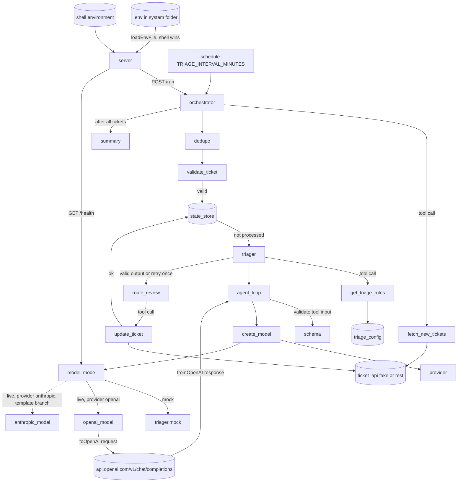
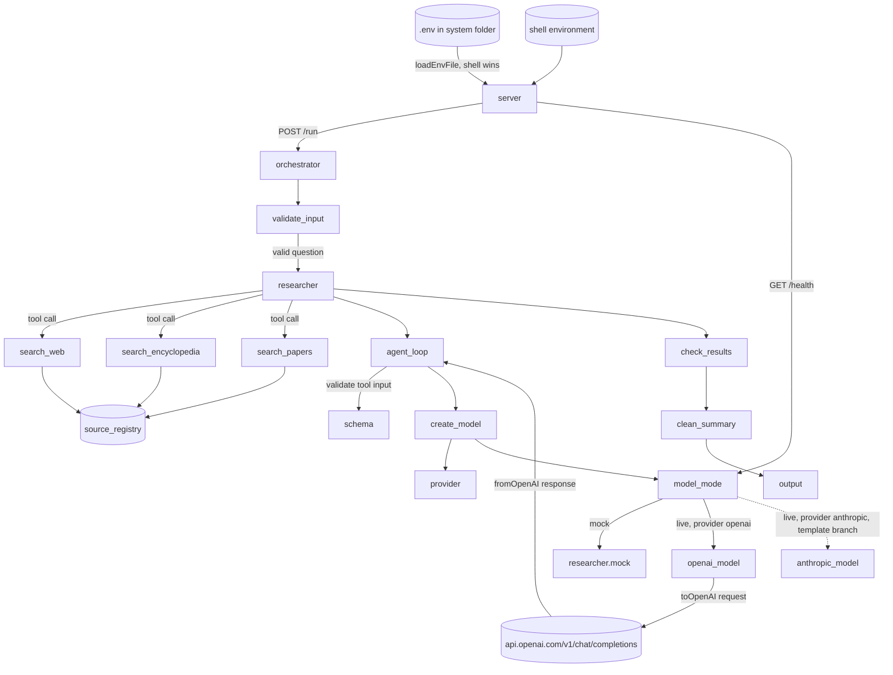

PASS

# Visual report: round 1

Job: 20261026-openai-env. Branch: okati/20261026-openai-env (commit 160b10e). Worktree: `.okati/worktrees/20261026-openai-env/`.
System folders: `systems/support-triage/`, `systems/research-summary/`. Mode: static code reading only. No server was started and no model call was made (AGENT_MODE=mock rule).

Diagram files: `round-1/diagrams/support-triage/agent-graph.mmd`, `round-1/diagrams/research-summary/agent-graph.mmd`.

## Code graph

### support-triage

### research-summary

## Agents and tools found in code

| System | Agent (file) | Tools in `tools` list | Model field |
| --- | --- | --- | --- |
| support-triage | `triager` (`agents/triager.js`) | `get_triage_rules` | `claude-sonnet-5-5` (unchanged) |
| research-summary | `researcher` (`agents/researcher.js`) | `search_web`, `search_encyclopedia`, `search_papers` | `claude-sonnet-5-5` (unchanged) |

Tools that only the orchestrator calls (not the model): `fetch_new_tickets`, `update_ticket` (support-triage). Both match the system graph in `README.md`.

## Differences from design.md

The design graph shows the model path of both systems. It points to the system `README.md` graphs for the other nodes. Both were compared.

| Type | Item | In design | In code |
| --- | --- | --- | --- |
| missing agent | none | triager, researcher | triager, researcher |
| extra agent | none | - | none |
| missing tool | none | get_triage_rules; search_web, search_encyclopedia, search_papers | all four present |
| extra tool | none | - | none (fetch_new_tickets and update_ticket are orchestrator-only, in the README graph) |
| missing call | none | all edges of the design graph | all present |
| extra call | none | - | none |

Edge check (design graph to code):

- `.env` and shell to `server`: `server.js` main block, `process.loadEnvFile` then `checkPort` (both systems).
- `server` to `orchestrator` (`run`) and to `model_mode` (`/health`): present in both `server.js`.
- `orchestrator` to `triager` / `researcher`: `runAgent(triager, ...)` and `runAgent(agent, ...)`.
- `triager` to `get_triage_rules`; `researcher` to three search tools: `tools` lists.
- `agent_loop` to `schema` (`validate`), to `create_model` (default `model` argument, and `countingModel` / `modelFor` in the orchestrators).
- `create_model` to `provider` and `model_mode`; `model_mode` to `mock_policy` (`agent.mock`) and to `openai_model` (live, openai); `openai_model` to `OPENAI_URL` with `toOpenAI` and `fromOpenAI`: all in `lib/llm.js`.
- The three `lib/` files are byte-identical in both systems (`cmp` of `llm.js` and `agent-loop.js` between systems: equal).

Notes (not counted as differences):

- `lib/llm.js` is the template copy (design guardrail G1) and has an `anthropic_model` branch for `AGENT_PROVIDER=anthropic`. The design names this provider value in the `provider()` contract, and the edge label `live, provider openai` shows that the graph covers one branch. The branch is drawn as a dotted edge in the code graph. `.env.example` sets `AGENT_PROVIDER=openai`. No OpenAI or Anthropic request was made.
- `modelMode()` reads the key through the internal `apiKey()` helper, which calls `provider()`. The design describes the `modelMode()` input as "the provider key". This helper is not a node, so it is not drawn.
- `research-summary/server.js` already had the `.env` load line before this job. The design graph shows `env_file` for both systems, so this agrees.
- Node labels differ in places (for example `mock_policy` is `triager.mock` or `researcher.mock`). Labels are not differences.

## Screenshots

None. Neither system has a user interface. Both are JSON HTTP servers (`POST /run`, `GET /health`).
