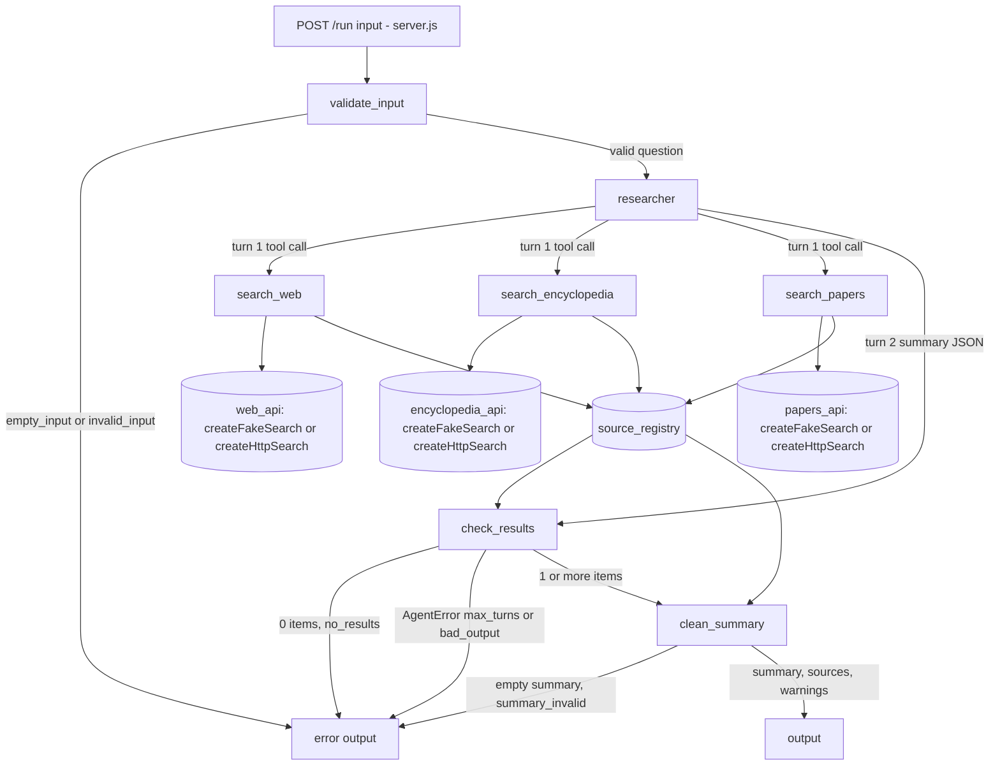

PASS

# Visual report: round 1

Code read from `/home/user/.okati/worktrees/20261026-research-summary/systems/research-summary/` (branch `okati/20261026-research-summary`, commit 9786046). Diagram file: `diagrams/agent-graph.mmd`.

Agents found: 1 (`researcher`, file `agents/researcher.js`, `tools` list = `search_web`, `search_encyclopedia`, `search_papers`, set by `orchestrator.js` through `createResearcher(tools)`). Tools found: 3 (`tools/search-web.js`, `tools/search-encyclopedia.js`, `tools/search-papers.js`, all built by `createSearchTool` in `tools/search-tool.js`). Deterministic steps: `validateInput`, `checkResults` (`orchestrator.js`), `cleanSummary` (`steps/clean-summary.js`). Data stores: `createSourceRegistry()` and 3 adapters (`createFakeSearch` by default, `createHttpSearch` only with `SEARCH_ADAPTER=http`).

## Code graph

## Differences from design.md
| Type | Item | In design | In code |
|------|------|-----------|---------|
| (none) | Missing agent | - | - |
| (none) | Extra agent | - | - |
| (none) | Missing tool | - | - |
| (none) | Extra tool | - | - |
| (none) | Missing call | - | - |
| (none) | Extra call | - | - |

Notes (not differences):
- The design sends the `max_turns` and `bad_output` errors from `check_results` in its sequence text (step 6) but not as a separate graph edge. The code implements this in the same node (`check_results` -> `error_out`). I added the edge label to the code graph. The design text covers it.
- `search_calls` in the output is read from the adapters' `calls` arrays in `orchestrator.js`. The design describes this in the Output table, not in the graph.
- `createHttpSearch` is the alternative to `createFakeSearch` for the adapter nodes, as the design says (select with `SEARCH_ADAPTER=http`, default `fake`).
- Each tool has exactly the agent tool list of the design. The model cannot give a query (input schema is an empty object). There is no fetch tool.

## Screenshots
None. The system has no user interface. It is an HTTP JSON API (`POST /run`, `GET /health`). I started it with `AGENT_MODE=mock PORT=3217 node server.js`. `GET /health` returned `{"status":"ok","mode":"mock"}` and `POST /run` with `What is CRISPR?` returned an `output` object. I stopped the server afterwards.
