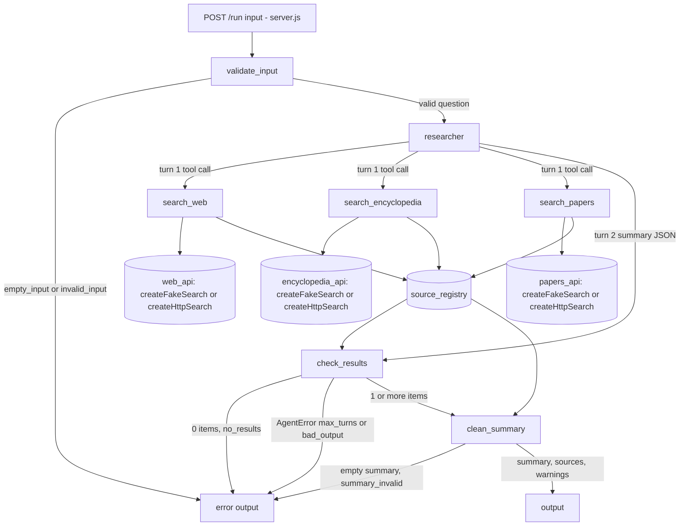

PASS

# Visual report: round 2

Code read from `/home/user/.okati/worktrees/20261026-research-summary/systems/research-summary/` (branch `okati/20261026-research-summary`, commit 719bb61). Diagram file: `diagrams/agent-graph.mmd`.

The only change since round 1 (commit 9786046) is one line in `README.md`. No agent, tool, call, fixture or `lib/` file changed. `lib/agent-loop.js`, `lib/llm.js` and `lib/schema.js` are identical to the template.

Agents found: 1 (`researcher`, `agents/researcher.js`). The orchestrator passes the `tools` list through `createResearcher(tools)`: `search_web`, `search_encyclopedia`, `search_papers`.

Tools found: 3 (`tools/search-web.js`, `tools/search-encyclopedia.js`, `tools/search-papers.js`, all built by `createSearchTool` in `tools/search-tool.js`).

Deterministic steps: `validateInput` and `checkResults` (`orchestrator.js`), `cleanSummary` (`steps/clean-summary.js`).

Data stores: `createSourceRegistry()` and 3 adapters (`createFakeSearch` by default, `createHttpSearch` only with `SEARCH_ADAPTER=http`).

## Code graph

## Differences from design.md
| Type | Item | In design | In code |
|------|------|-----------|---------|
| (none) | Missing agent | - | - |
| (none) | Extra agent | - | - |
| (none) | Missing tool | - | - |
| (none) | Extra tool | - | - |
| (none) | Missing call | - | - |
| (none) | Extra call | - | - |

Notes (not differences):
- The code graph adds the edge `check_results -> error_out` for `AgentError` (`max_turns`, `bad_output`). `design.md` describes it in "Sequence for one request", step 6, but not in the Mermaid graph. The edge ends at the same `error_out` node.
- The adapter labels name `createHttpSearch` as an alternative. `design.md` names it under "Generic HTTP adapter". It is the same node `*_api`.

## Screenshots
None. The system has no user interface. It has `POST /run` and `GET /health` only, and `server.js` serves no HTML page.
