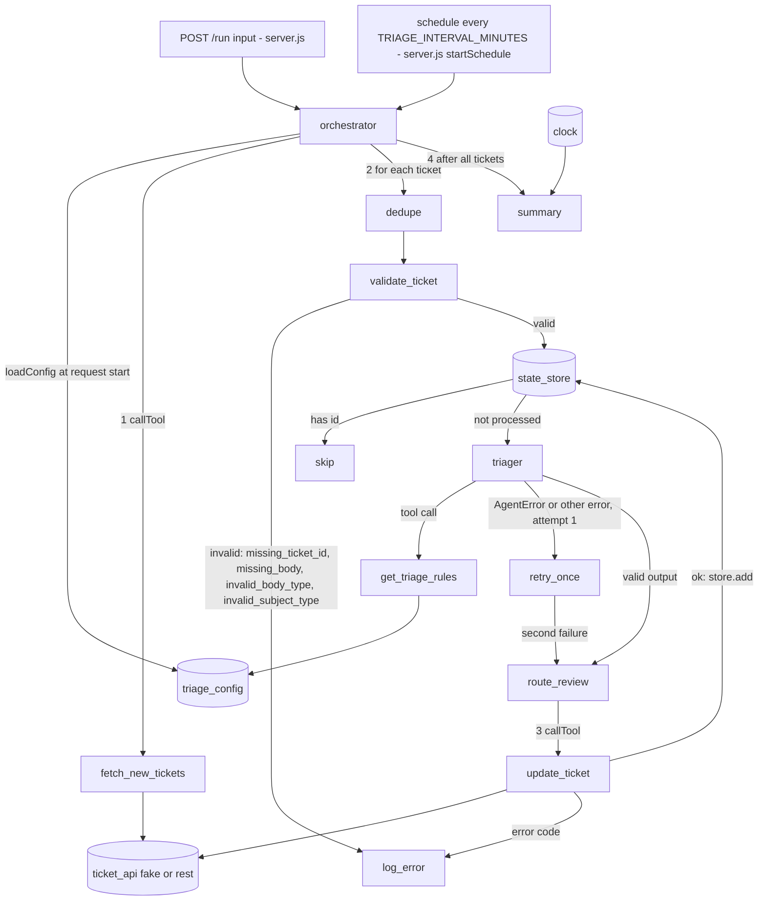

PASS

# Visual report: round 2

Job: 20261026-support-triage. Branch: okati/20261026-support-triage. Worktree: `/home/user/.okati/worktrees/20261026-support-triage` (system folder `systems/support-triage/`). HEAD: `7df9614`.

Files read: `agents/triager.js`, `orchestrator.js`, `server.js`, `tools/*.js`, `adapters/*.js`, `lib/agent-loop.js`. `git diff 5d1cbda 7df9614` shows that round 2 changed only `lib/agent-loop.js` (the `MAX_TURNS = 5` cap). No agent, tool or call changed since round 1.

## Code graph

Source: `diagrams/agent-graph.mmd`

### Agents and tools found in code

| Agent or caller | Tools it can call | Evidence |
|---|---|---|
| `triager` (model `claude-sonnet-5-5`) | `get_triage_rules` only | `agents/triager.js`: `tools: [getTriageRules]` |
| `orchestrator` (code, not a model agent) | `fetch_new_tickets`, `update_ticket` through `callTool` | `orchestrator.js`: `fetchTool`, `updateTool` |

`fetch_new_tickets` and `update_ticket` are in the tools list of no agent. Only one agent exists (`triager`). `lib/agent-loop.js` lets an agent call only its own tools.

## Differences from design.md

| Type | Item | In design | In code |
|---|---|---|---|
| (none) | Missing agent | - | - |
| (none) | Extra agent | - | - |
| (none) | Missing tool | - | - |
| (none) | Extra tool | - | - |
| (none) | Missing call | - | - |
| (none) | Extra call | - | - |

Result: 0 differences. Notes (not differences):

- The orchestrator calls `loadConfig()` at the start of each request and `triager.js` calls it when it loads (same as round 1). It is a config check, not a new agent, tool or call between nodes.
- The scheduled runner logs a `run_failed` event, which is not in the design list of events. It is a log event, not a graph element.
- Errors that are not `AgentError` also use the retry path. Same graph edge.

## Screenshots

None. The system has no user interface. It is an HTTP API only (`GET /health`, `POST /run`, port 3142), so there is no page to capture.
