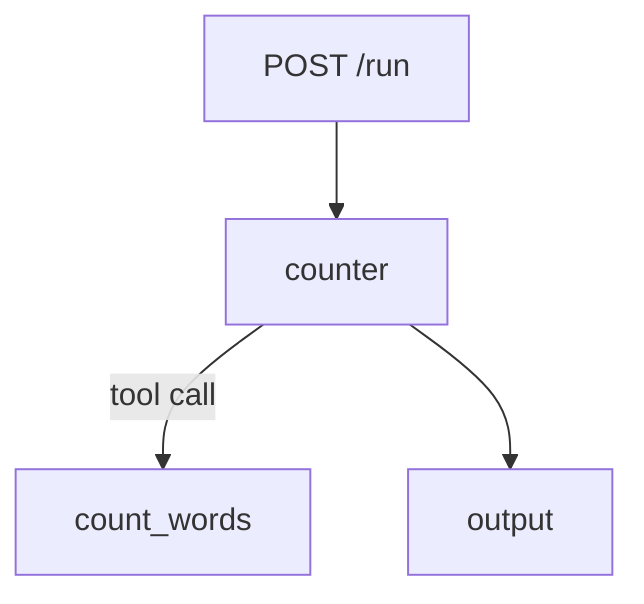

# Word counter (okati template)

Goal: report the number of words in a text. One agent (`counter`) uses one tool (`count_words`).

## Agent graph



## Commands

| Command | Result |
| --- | --- |
| `npm start` | Starts the server on `PORT` (default 3100) |
| `npm test` | Runs the unit tests and one test for each evaluation case |
| `npm run evals` | Runs the evaluation cases in process |
| `node evals/run-evals.js --url http://localhost:3100` | Runs the evaluation cases on a running server |

## Environment variables

| Name | Default | Meaning |
| --- | --- | --- |
| `PORT` | 3100 | Port from 3000 to 3999 |
| `AGENT_MODE` | auto | auto, mock or live |
| `AGENT_PROVIDER` | openai | Model provider |
| `OPENAI_API_KEY` | empty | OpenAI key. Needed only in live mode. |
| `OPENAI_MODEL` | empty | OpenAI model name. Needed only in live mode. |

Optional: set `AGENT_PROVIDER=anthropic`, `ANTHROPIC_API_KEY` and `AGENT_MODEL` to use Anthropic instead.

To add your keys, copy `.env.example` to `.env` in this folder and fill in the values.
`npm start` reads `.env`. Git ignores `.env`.

## Example

```bash
curl -s localhost:3100/run -H 'content-type: application/json' -d '{"input":"the quick brown fox"}'
# {"output":{"words":4}}
```
