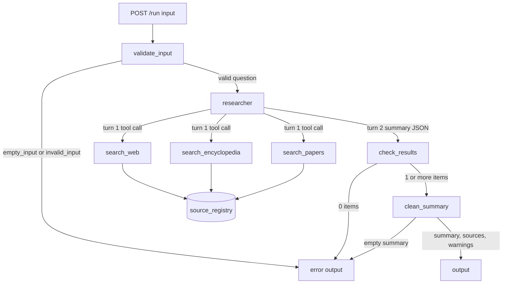

# Research summary

Goal: answer one research question with a short summary that cites its sources.
One agent (`researcher`) calls three search tools (`search_web`, `search_encyclopedia`, `search_papers`) in one turn.
Each tool searches for the question that the orchestrator gives it (the model cannot write the query), keeps a maximum of 3 results, removes duplicate URLs and numbers each new result in a shared source registry.
The agent writes a summary with `[n]` markers. The orchestrator removes each marker that is not in the registry, removes each sentence with no marker, and keeps the summary at 250 words or fewer.

## Agent graph



## Commands

| Command | Result |
| --- | --- |
| `AGENT_MODE=mock PORT=3217 npm start` | Starts the server on port 3217 with the mock model and the fake search adapters |
| `npm test` | Runs the unit tests and one test for each evaluation case |
| `npm run evals` | Runs the evaluation cases in process |
| `node evals/run-evals.js --url http://localhost:3217` | Runs the evaluation cases on a running server |

## API

`POST /run` with `{"input": "<question>"}` returns `{"output": {...}}` or `{"error": "<code>"}`.
`GET /health` returns `{"status": "ok", "mode": "mock"}` or `"live"`.

Output keys: `summary`, `sources` (`{n, title, url, source}`), `warnings`, `cited_sources`, `search_calls`, `model_calls`.

Error codes: `invalid_input`, `empty_input`, `no_results`, `summary_invalid`, `max_turns`, `bad_output`, `internal_error`, and from the server `bad_json`, `payload_too_large`, `not_found`.

## Environment variables

| Name | Default | Meaning |
| --- | --- | --- |
| `PORT` | 3217 | Port from 3000 to 3999 |
| `AGENT_MODE` | auto | auto, mock or live |
| `AGENT_PROVIDER` | openai | Model provider. Use openai. |
| `OPENAI_API_KEY` | empty | OpenAI key. Needed only in live mode. |
| `OPENAI_MODEL` | empty | OpenAI model name. Needed only in live mode. |
| `SEARCH_ADAPTER` | fake | fake or http |
| `WEB_SEARCH_URL` | empty | Needed only for the http adapter |
| `WEB_SEARCH_KEY` | empty | Needed only for the http adapter |
| `ENCYCLOPEDIA_URL` | empty | Needed only for the http adapter |
| `PAPERS_URL` | empty | Needed only for the http adapter |
| `PAPERS_KEY` | empty | Needed only for the http adapter |

To add keys, copy `.env.example` to `.env` in this folder and fill in the keys. `npm start` reads `.env`. A variable that is set in the shell has priority over `.env`. Git ignores `.env`. Do not commit a `.env` file or a key. `npm start` needs Node.js 20.12 or later.
Tests and the localhost run use mock mode and the fake adapters with the data in `fixtures/`.

## Example

```bash
curl -s localhost:3217/run -H 'content-type: application/json' -d '{"input":"What is CRISPR?"}'
```
