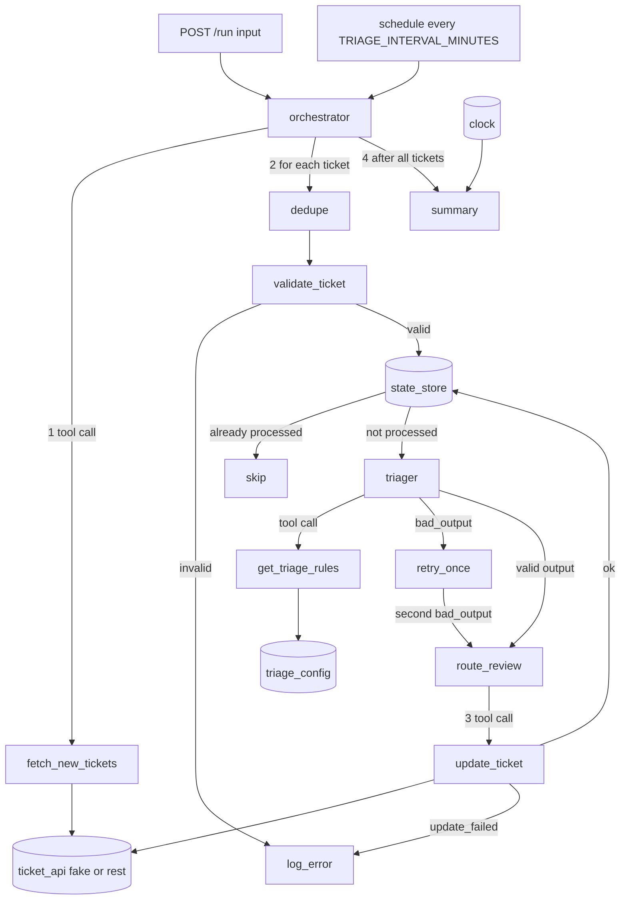

# Support ticket triage (okati system)

Goal: read each new support ticket and set one team and one priority on that ticket.
One agent (`triager`) classifies each valid ticket. All other steps (fetch, validate, deduplicate,
route to review, update, summary) are deterministic code in `orchestrator.js`.
The model never writes to the ticket system. Only the orchestrator calls `fetch_new_tickets` and `update_ticket`.

## Agent graph



## Commands

| Command | Result |
| --- | --- |
| `AGENT_MODE=mock PORT=3142 npm start` | Starts the server on port 3142 with the mock model |
| `npm test` | Unit tests for each tool and adapter, and one test for each evaluation case |
| `npm run evals` | Runs the evaluation cases in process |
| `node evals/run-evals.js --url http://localhost:3142` | Runs the evaluation cases on a running server |

## Example

```bash
curl -s localhost:3142/health
# {"status":"ok","mode":"mock"}
curl -s localhost:3142/run -H 'content-type: application/json' -d '{"input":{"ticket_set":"all"}}'
```

`POST /run` input keys (all optional): `ticket_set`, `ticket_ids`, `runs`, `fail_update_ids`,
`processed_ids`, `include_records`. See `design.md` of the job for the full contract.

## Environment variables

| Name | Default | Meaning |
| --- | --- | --- |
| `PORT` | 3142 | Port from 3000 to 3999 |
| `AGENT_MODE` | auto | auto, mock or live |
| `ANTHROPIC_API_KEY` | empty | Needed only in live mode |
| `AGENT_MODEL` | claude-sonnet-5-5 | Model for live mode |
| `TICKET_ADAPTER` | fake | fake or rest |
| `TICKET_API_URL` | empty | Needed only for the rest adapter |
| `TICKET_API_TOKEN` | empty | Needed only for the rest adapter |
| `TRIAGE_CONFIG` | fixtures/triage_config.json | Path of the configuration file |
| `TRIAGE_INTERVAL_MINUTES` | 0 | Schedule interval. 0 is off. Production value is 5 |
| `TRIAGE_CLOCK` | fixed with the fake adapter | fixed or system |
| `TRIAGE_LOG` | on | on or off |

Keys are read from the environment only. Do not put a key in a file in the repository.
